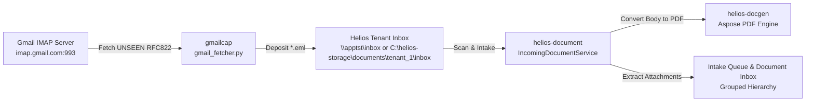

# Gmail Intake & Capture Service (`gmailcap`)

Automated email intake daemon for the **Helios Insurance Management Suite**. Connects to Gmail over IMAP SSL, searches for unread emails (`UNSEEN`), extracts raw RFC822 `.eml` messages, and drops them into the monitored Helios tenant document inbox directory.

---

## Architecture & Integration with Helios



1. **Email Retrieval**: `gmail_fetcher.py` connects via SSL (`imap.gmail.com:993`) and fetches raw email message streams.
2. **Inbox Drop**: Messages are saved as `<Sanitized_Subject>_<Email_ID>.eml` directly into the designated inbox path (e.g. `\\apptst\inbox`).
3. **Automated Helios Ingestion**:
   - `helios-document` scans the inbox directory, converts the email body to a structured PDF document via `helios-docgen`, extracts all file attachments, and clusters them under a common `GROUP_ID`.
   - In the frontend **Document Inbox**, the email is displayed as the parent with attachments indented as children, ready for underwriting review and submission attachment.

---

## Prerequisites & Installation

- Python 3.10+
- Uses standard library modules only (`imaplib`, `email`, `re`, `os`, `sys`). No external pip dependencies required.

---

## Configuration

Credentials and target paths are defined in `gmail_fetcher.py` and can also be overridden via environment variables:

| Setting | Default | Description |
| :--- | :--- | :--- |
| `IMAP_SERVER` | `imap.gmail.com` | Gmail IMAP host |
| `IMAP_PORT` | `993` | IMAP SSL port |
| `EMAIL_ACCOUNT` | `netyxmail@gmail.com` | Target intake mailbox |
| `APP_PASSWORD` | App-specific password | Google App Password for IMAP access |
| `TARGET_DIR` | `\\apptst\inbox` | Target directory for `.eml` files |

---

## Running the Fetcher

```powershell
python gmail_fetcher.py
```

Can be scheduled as a recurring Windows Task or run on-demand alongside the Helios suite.
