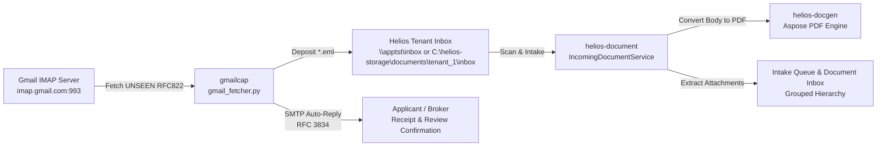

# Gmail Intake & Capture Service (`gmailcap`)

Automated email intake and underwriting acknowledgement daemon for the **Helios Insurance Management Suite**. Connects to Gmail over IMAP SSL, searches for unread emails (`UNSEEN`), extracts raw RFC822 `.eml` messages, drops them into the monitored Helios tenant document inbox directory, and immediately dispatches an automated receipt confirmation back to the applicant/broker via SMTP.

---

## Architecture & Integration with Helios



1. **Email Retrieval**: `gmail_fetcher.py` connects via SSL (`imap.gmail.com:993`) and fetches raw email message streams.
2. **Inbox Drop**: Messages are saved as `<Sanitized_Subject>_<Email_ID>.eml` directly into the designated inbox path (e.g. `\\apptst\inbox`).
3. **Automated Submission Receipt & Underwriting Auto-Reply**:
   - `gmail_fetcher.py` analyzes the `From` header and message headers using RFC 3834 standard loop prevention rules (ignoring mailing lists, daemons, no-reply bots, and auto-replies).
   - Automatically dispatches a dual-part (responsive HTML + Plain Text) branded confirmation acknowledging the submission (`HELIOS-SUB-<ID>`), informing the sender that the underwriting team is reviewing the documentation and to expect a response shortly.
4. **Automated Helios Document Ingestion**:
   - `helios-document` scans the inbox directory, converts the email body to a structured PDF document via `helios-docgen`, extracts all file attachments, and clusters them under a common `GROUP_ID`.
   - In the frontend **Document Inbox**, the email is displayed as the parent with attachments indented as children, ready for underwriting review and submission attachment.

---

## Prerequisites & Installation

- Python 3.10+
- Uses standard library modules only (`imaplib`, `smtplib`, `email`, `re`, `os`, `sys`). No external pip dependencies required.

---

## Configuration

Credentials and target paths are defined in `gmail_fetcher.py` and can also be overridden via environment variables:

| Setting | Default | Description |
| :--- | :--- | :--- |
| `IMAP_SERVER` | `imap.gmail.com` | Gmail IMAP host |
| `IMAP_PORT` | `993` | IMAP SSL port |
| `SMTP_SERVER` | `smtp.gmail.com` | Gmail SMTP host |
| `SMTP_PORT` | `587` | SMTP STARTTLS port |
| `EMAIL_ACCOUNT` | `netyxmail@gmail.com` | Target intake & reply mailbox |
| `APP_PASSWORD` | App-specific password | Google App Password for IMAP & SMTP access |
| `GMAIL_AUTO_REPLY`| `true` | Enable or disable auto-replies (`true`/`false`) |
| `HELIOS_SENDER_NAME`| `Helios Underwriting Team` | Display name for confirmation emails |
| `TARGET_DIR` | `\\apptst\inbox` | Target directory for `.eml` files |
| `LOG_DIR` | `C:\helios-storage\logs` | Heartbeat & telemetry JSON output directory |

---

## Running the Fetcher

### Single Run (Windows Task Scheduler / Cron)
```powershell
python gmail_fetcher.py
```

### Persistent Background Daemon (1-Minute Interval)
```powershell
python gmail_fetcher.py --loop 60
```
